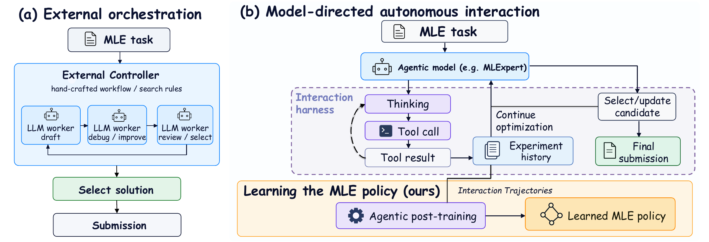
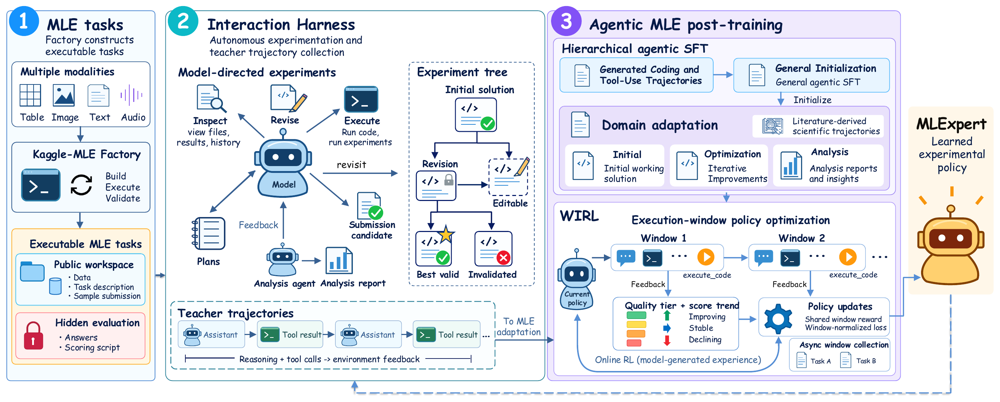
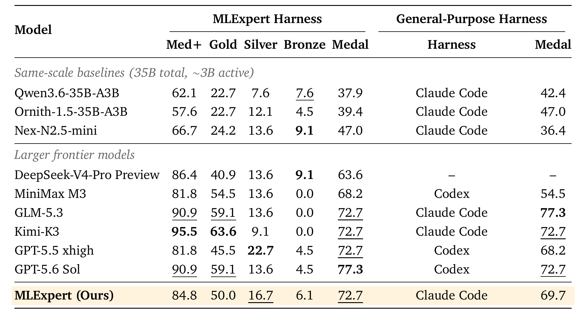
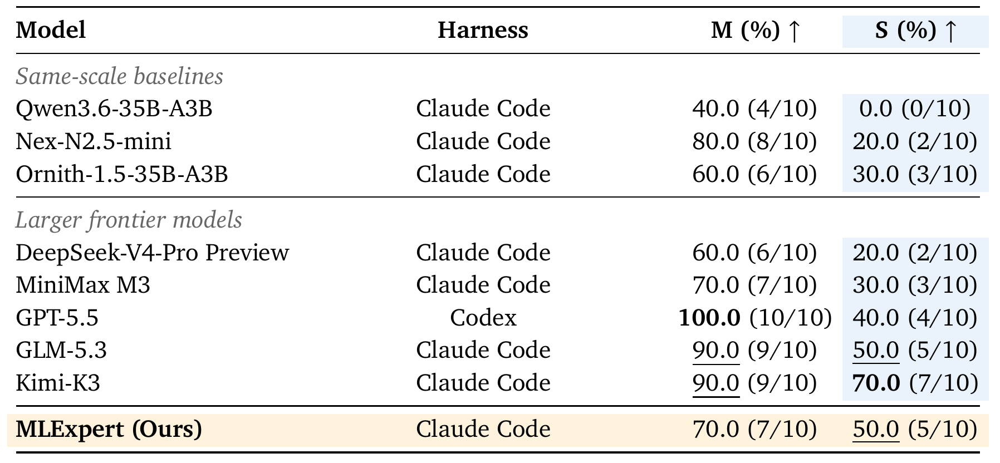

# MLExpert: Towards a Generalist Agentic Model for Autonomous Machine Learning Engineering

<p align="center">
  <a href="https://huggingface.co/InternScience/MLExpert">🤗 Model</a>
  &nbsp; · &nbsp;
  <a href="paper/MLExpert_agentic_mle_arxiv.pdf">📄 Paper</a>
  &nbsp; · &nbsp;
  <a href="https://huggingface.co/InternScience/MLExpert/blob/main/LICENSE">⚖️ Model License</a>
</p>

**MLExpert** is a 35B Mixture-of-Experts agentic model for autonomous machine learning engineering. It organizes experiments, writes and revises code, and improves solutions through sustained interaction with execution environments. Hierarchical agentic supervised fine-tuning (SFT) develops general tool-use and domain-specific optimization skills, while **Windowed Interaction Reinforcement Learning (WIRL)** trains multi-turn decisions using feedback from completed experiments.

## Highlights

- **Long-horizon optimization:** Plans experiments, interprets execution feedback, revisits previous solutions, and selects submission candidates within a persistent workspace.
- **MLE performance:** Achieves a **72.7% medal rate on MLE-Bench Lite**, matching GLM-5.3 and Kimi-K3 under the MLExpert Harness.
- **General-purpose harness compatibility:** Achieves a **69.7% medal rate with Claude Code**, compared with 42.4% for its base model.
- **Scientific task optimization:** Matches published scientific results on seven of ten NatureBench Lite tasks and surpasses them on five.

## Method

### Model-directed MLE

The model selects subsequent actions based on experimental states and execution feedback. The interaction harness maintains candidate solutions and experiment history throughout long-horizon optimization.



### Task construction and post-training

The **Kaggle-MLE Factory** constructs executable machine learning tasks. The interaction harness supports model-directed experimentation and teacher trajectory collection. **Hierarchical agentic SFT** transfers general coding and tool-use capabilities to MLE through outcome-guided supervision. **WIRL** groups decisions between successive experiment results into execution windows and learns from intermediate execution feedback through asynchronous collection and policy correction.



## Performance

### MLE-Bench Lite

MLE-Bench Lite comprises 22 historical Kaggle competitions for end-to-end machine learning engineering. The main metric is the percentage of tasks receiving any medal. Under the MLExpert Harness, MLExpert raises its base model's medal rate from **37.9% to 72.7%**. With Claude Code, the rate improves from **42.4% to 69.7%**.



### NatureBench Lite

NatureBench Lite comprises ten scientific experimentation tasks. **M** denotes Match-SOTA, and **S** denotes Surpass-SOTA. With Claude Code, MLExpert raises the Surpass-SOTA rate from **0.0% to 50.0%** and the Match-SOTA rate from **40.0% to 70.0%** relative to its base model.



## Usage

**MLExpert** model weights are available on [Hugging Face](https://huggingface.co/InternScience/MLExpert). The commands below serve an OpenAI-compatible API at `http://localhost:8000/v1` with tensor parallelism across two GPUs.

### vLLM

```shell
uv venv --python 3.12 --seed --managed-python
source .venv/bin/activate
uv pip install vllm --torch-backend=auto
```

**Text generation**

```shell
vllm serve InternScience/MLExpert \
    --host 127.0.0.1 \
    --port 8000 \
    --tensor-parallel-size 2 \
    --max-model-len 262144 \
    --reasoning-parser qwen3 \
    --language-model-only
```

**Tool calling**

```shell
vllm serve InternScience/MLExpert \
    --host 127.0.0.1 \
    --port 8000 \
    --tensor-parallel-size 2 \
    --max-model-len 262144 \
    --reasoning-parser qwen3 \
    --enable-auto-tool-choice \
    --tool-call-parser qwen3_coder \
    --language-model-only
```

### SGLang

```shell
uv venv --python 3.12 --seed --managed-python
source .venv/bin/activate
uv pip install sglang
```

**Text generation**

```shell
python -m sglang.launch_server \
    --model-path InternScience/MLExpert \
    --host 127.0.0.1 \
    --port 8000 \
    --tp-size 2 \
    --context-length 262144 \
    --reasoning-parser qwen3 \
    --language-model-only
```

**Tool use**

```shell
python -m sglang.launch_server \
    --model-path InternScience/MLExpert \
    --host 127.0.0.1 \
    --port 8000 \
    --tp-size 2 \
    --context-length 262144 \
    --reasoning-parser qwen3 \
    --tool-call-parser qwen3_coder \
    --language-model-only
```

### Sampling parameters

| Parameter | Value |
| :--- | ---: |
| `temperature` | 1.0 |
| `top_p` | 0.95 |
| `top_k` | 20 |
| `min_p` | 0.0 |
| `presence_penalty` | 1.5 |
| `repetition_penalty` | 1.0 |

These parameters apply to both thinking and non-thinking modes. Set `chat_template_kwargs.enable_thinking` to `true` to enable thinking or `false` to disable it. Machine-readable profiles are provided in the model repository's [inference_profiles.json](https://huggingface.co/InternScience/MLExpert/blob/main/inference_profiles.json).
